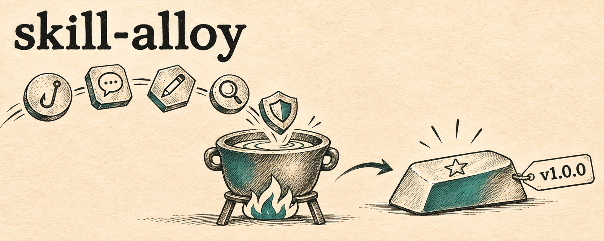

<p align="center">
  
</p>

<p align="center">
  <a href="README.md">English</a> · <b>한국어</b>
</p>

# skill-alloy

**흩어진 오픈소스 에이전트 스킬을 녹여 더 강한 스킬 하나로 만들고, 배포까지.**

skill-alloy는 Claude Code(와 Codex)용 에이전트 스킬입니다. 주제를 주면 GitHub에서 관련 스킬을 찾고, 안전한지 검사하고, 실제 작업에 돌려보고, 서로 부딪히는 규칙을 정리해서, 새로 쓴 스킬 하나를 오픈소스 저장소로 릴리스까지 올립니다.

## 왜 만들었나

한국어 SNS 글쓰기 스킬 [`ssul`](https://github.com/nathankim0/ssul)을 만들 때, 스킬 저장소 16개를 깔고 실제 글에 돌려보느라 하루가 걸렸습니다. 결과물의 품질을 가른 건 두 가지였습니다.

1. **스킬을 읽는 것과 쓰는 것은 다릅니다.** 초반 결과물은 스킬을 참고한 것처럼 보였지만 실제로는 아니었습니다. 스킬을 하나씩 실제로 불러서 돌려본 뒤에야 빈틈이 보였습니다.
2. **합친 스킬은 원본끼리 부딪히는 곳에서 깨집니다.** 한 스킬은 문장 리듬을 바꾸지 말라 하고, 다른 스킬은 꼭 바꾸라 했습니다. 대비형 첫 줄을 권하는 스킬과 "X가 아니라 Y"를 금지하는 스킬도 있었습니다. 충돌을 전부 적고 하나씩 기준을 정한 표가 가장 값진 결과였습니다.

skill-alloy는 그 하루를 반복 가능한 절차로 만든 것입니다.

## 하는 일

| 단계 | 내용 |
|---|---|
| 1. 범위 | 합칠 스킬이 할 일을 한 줄로 정리. 이전 실패는 요구사항이 됨 |
| 2. 탐색 | 영어와 대상 언어로 GitHub 검색, 스팸 저장소 거르기 |
| 3. 검사 | 격리된 폴더에 클론, SKILL.md·훅·스크립트를 모두 읽고 라이선스 확인 |
| 4. 설치 | 플러그인 마켓플레이스 또는 스킬 폴더, 이름 충돌은 바꿔서 설치 |
| 5. 시험 | 각 스킬을 실제 작업에 불러서 잡은 것과 놓친 것을 기록 (필수) |
| 6. 합성 | 200줄 이내 SKILL.md와 references, 충돌 기준표 `conflicts.md`를 새로 작성 |
| 7. 패키징 | 플러그인 매니페스트와 ATTRIBUTIONS를 쓰고, 나머지는 [ossify](https://github.com/nathankim0/ossify)로: AGENTS.md + CLAUDE.md 심볼릭 링크, 영어·한국어 README, GPT로 만든 배너, LICENSE, CHANGELOG |
| 8. 개인정보 검사 | 회사명, 이메일, 내부 경로, 토큰이 공개 저장소에 들어가지 않게 |
| 9. 배포 | 공개 저장소를 만들고 ossify 릴리스 모드로 `v1.0.0` 태그와 GitHub 릴리스, 토픽 |
| 10. 확인 | GitHub에서 다시 설치, 배너 주소, 심볼릭 링크, 릴리스 확인 |

패키징과 릴리스는 [ossify](https://github.com/nathankim0/ossify)가 맡습니다. 그래서 만들어지는 저장소마다 `AGENTS.md`가 들어갑니다. 이후 작업하는 에이전트는 수정할 때마다 커밋하고 push하며, 스킬 자체가 바뀔 때만 릴리스(버전 올림, CHANGELOG, 태그)합니다.

## 예시

```text
/skill-alloy AI 티 안 나는 한국어 스레드 글, 저장소 이름은 ssul
```

결과: [nathankim0/ssul](https://github.com/nathankim0/ssul). 원본 저장소 16개를 검토했고 충돌 14개에 기준을 정했습니다. 이 페이지의 배너도 같은 방식으로 만들었습니다.

## 필요한 것

- 로그인된 [GitHub CLI](https://cli.github.com/) (`gh auth status`)
- Claude Code (`claude plugin validate`와 설치 확인용)
- 저장소 규칙과 릴리스용 [ossify](https://github.com/nathankim0/ossify) (없으면 자동 설치)
- 배너용: 이미지 생성이 켜진 [Codex CLI](https://github.com/openai/codex) 또는 `OPENAI_API_KEY`. 둘 다 없으면 배너 없이 배포합니다.

## 설치

### Claude Code (플러그인)

```text
/plugin marketplace add nathankim0/skill-alloy
/plugin install skill-alloy@skill-alloy
```

### Claude Code 또는 Codex (직접 복사)

```bash
git clone https://github.com/nathankim0/skill-alloy.git
cp -R skill-alloy/skills/skill-alloy ~/.claude/skills/skill-alloy   # Claude Code
cp -R skill-alloy/skills/skill-alloy ~/.codex/skills/skill-alloy    # Codex
```

### Agent Skills를 지원하는 에이전트

```bash
npx skills add nathankim0/skill-alloy
```

## 사용법

```text
/skill-alloy <주제> [저장소 이름]
/skill-alloy owner/a owner/b owner/c 합쳐서 <이름> 스킬로 만들어줘
```

요청에 "올려줘", "배포해줘"가 있을 때만 바로 공개 저장소를 만듭니다. 없으면 한 번 확인합니다.

## 구성

```text
skills/skill-alloy/SKILL.md            절차 본문
skills/skill-alloy/references/
  discovery.md                         검색어, 거르는 기준, 스팸 신호
  vetting.md                           격리, 훅·스크립트 검사, 라이선스
  synthesis.md                         규칙 추출, 충돌 기준표, SKILL.md 작성법
  packaging.md                         플러그인 매니페스트, ATTRIBUTIONS, ossify에 넘길 내용
  publishing.md                        추가 개인정보 검사어, 릴리스 노트 추가 내용, 플러그인 확인
.claude-plugin/                        Claude Code 플러그인·마켓플레이스 매니페스트
```

## 라이선스

[MIT](LICENSE)
