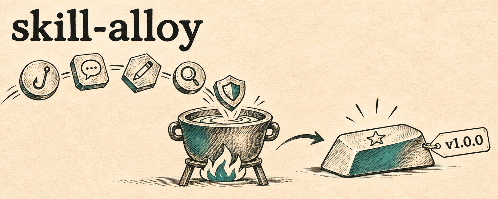

<p align="center">
  
</p>

<p align="center">
  <b>English</b> · <a href="README.ko.md">한국어</a>
</p>

# skill-alloy

**Melt many open-source agent skills into one stronger skill, and ship it.**

skill-alloy is an agent skill for Claude Code (and Codex) that takes a topic, finds the existing skills for it on GitHub, vets them, runs them on a real task, resolves the rules where they contradict each other, writes one original merged skill, and publishes it as an open-source repo with a release.

## Why it exists

Building [`ssul`](https://github.com/nathankim0/ssul) (a Korean social-post writing skill) took a day of installing 16 skill repos and running them on real posts. Two things decided whether the result was any good:

1. **Reading a skill is not using it.** The early drafts looked skill-informed and were not. Gaps only showed up once each skill was actually invoked on a real task.
2. **Merged skills break where sources disagree.** One skill said never vary rhythm, another said always vary it; one loved contrast hooks, another banned "not X but Y". Writing every conflict down and ruling on it was the most valuable part.

skill-alloy turns that day into a repeatable workflow.

## What it does

| Step | What happens |
|---|---|
| 1. Scope | one line on what the merged skill does; earlier failures become requirements |
| 2. Discover | GitHub search in English and the target language, with spam filters |
| 3. Vet | clone into isolation; read every SKILL.md, hook, and script; check licenses |
| 4. Install | plugin marketplaces or skill folders; rename collisions |
| 5. Trial | invoke each skill on a real task and record what it caught and missed (mandatory) |
| 6. Synthesize | original SKILL.md under 200 lines, references, and a `conflicts.md` ruling table |
| 7. Package | plugin manifests and ATTRIBUTIONS, then [ossify](https://github.com/nathankim0/ossify) for AGENTS.md + CLAUDE.md symlink, English and Korean READMEs, a GPT-generated banner, LICENSE, CHANGELOG |
| 8. Privacy scan | no company names, emails, internal paths, or tokens in a public repo |
| 9. Publish | public repo, then ossify's release mode for tag `v1.0.0` and the GitHub release; topics |
| 10. Verify | install from GitHub, check the banner URL, the symlink, and the release |

Packaging and releases are handled by [ossify](https://github.com/nathankim0/ossify), so every repo it creates gets an `AGENTS.md` that tells future agents to commit and push after every change, and to cut a release (version bump, CHANGELOG, tag) only when the skill itself changes.

## Example

```text
/skill-alloy Korean Threads posts that don't read like AI, repo name ssul
```

Result: [nathankim0/ssul](https://github.com/nathankim0/ssul), with 16 source repos studied and 14 conflicts ruled on. The banner on this page was made the same way.

## Requirements

- [GitHub CLI](https://cli.github.com/) logged in (`gh auth status`)
- Claude Code (for `claude plugin validate` and install checks)
- [ossify](https://github.com/nathankim0/ossify) for repo conventions and releases (installed automatically if missing)
- For the banner: [Codex CLI](https://github.com/openai/codex) with image generation enabled, or an `OPENAI_API_KEY`. Without either, the repo ships without a banner.

## Install

### Claude Code (plugin)

```text
/plugin marketplace add nathankim0/skill-alloy
/plugin install skill-alloy@skill-alloy
```

### Claude Code or Codex (manual)

```bash
git clone https://github.com/nathankim0/skill-alloy.git
cp -R skill-alloy/skills/skill-alloy ~/.claude/skills/skill-alloy   # Claude Code
cp -R skill-alloy/skills/skill-alloy ~/.codex/skills/skill-alloy    # Codex
```

### Any agent that supports Agent Skills

```bash
npx skills add nathankim0/skill-alloy
```

## Usage

```text
/skill-alloy <topic> [repo name]
/skill-alloy merge owner/a owner/b owner/c into one skill called <name>
```

It publishes a public repo only when your request says to upload or publish; otherwise it asks once.

## Repository layout

```text
skills/skill-alloy/SKILL.md            the workflow
skills/skill-alloy/references/
  discovery.md                         search queries, filters, spam signals
  vetting.md                           isolation, hook and script review, licenses
  synthesis.md                         extracting rules, the conflict table, writing SKILL.md
  packaging.md                         plugin manifests, ATTRIBUTIONS, what to hand to ossify
  publishing.md                        extra privacy terms, release-note extras, plugin verification
.claude-plugin/                        Claude Code plugin and marketplace manifests
```

## License

[MIT](LICENSE)
